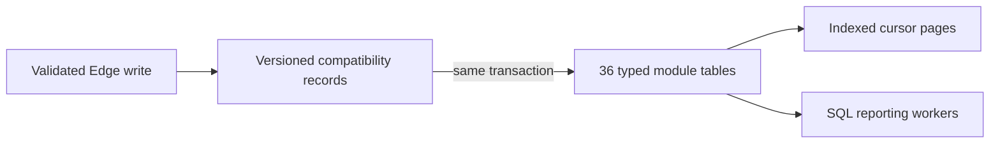

# Structured database and the 10-million-record target

The database now has 36 typed module tables in the `business` schema, alongside
the existing versioned `public.business_records` compatibility store. This is
an additive transition, not a destructive replacement of existing records.

Deployment verification on 19 October 2026: all 182 existing source rows were
backfilled and matched by section; all 36 tables have RLS enabled and none grant
browser SELECT privileges. The source identity/catalog constraints were validated.

## Structure

- `business.employees`, `customers`, `projects`, `tasks`, `task_comments`, `task_activity`.
- `invoices`, `invoice_items`, `quotations`, `quotation_items`, `receipts`,
  `receipt_allocations`, `credit_notes`, `credit_note_items`.
- `payroll`, `payroll_items`, `payslips`, `attendance`, `overtime`.
- `journals`, `journal_lines`, `income`, `expenses`, `assets`, and the remaining modules.

Each table has company-scoped primary keys, ordinals and versions, typed numeric
money values, date columns, deletion state and audit identity. Employee access
arrays remain JSONB because they are variable sets rather than monetary fields.
Source and parent foreign keys include company identity and record kind, preventing
cross-company links and references to the wrong record type. Source changes and
their typed projections commit or roll back together through a database trigger.
Source deletion cascades to its projection; soft deletion is preserved.

The projections are read-only to API workers. Browser roles cannot access them.
The existing Edge API continues enforcing employee permissions and field privacy.
The new structured-record endpoint is admin-only. Do not expose the business schema
in PostgREST or grant direct browser SELECT access: company-level RLS alone would
not reproduce employee SELF scope and private-field projection.

## Bounded reads

`GET /v1/companies/:companyId/structured-records/Invoices?after=0&limit=100`

returns typed snake_case rows and `nextCursor`. Pass the cursor to retrieve the
next page. A page is limited to 500 rows. A full final page may require an extra
request to establish that the scan has ended. Concurrent inserts may appear on
later pages; this is a live listing, not a repeatable-read export snapshot.

Trusted workers can use `public.structured_record_page` with the same limits.
Live-row indexes start with company identity and cursor ordinal. Additional
indexes cover status, employee/customer ownership, parent document identifiers
and document dates where those columns exist. Ledger amounts use Postgres numeric,
not binary floating-point arithmetic.

The existing RecordStore traversal now seeks on ordinal rather than increasing
OFFSET values. Its legacy 50,000-row safety limit remains deliberately in place.

## Backfill and maintenance

1. Run `node tool/generate_structured_schema.mjs --check` to check schema coverage.
2. Run `tool/sql/structured_preflight.sql` read-only. Resolve every reported anomaly.
3. Apply `202610190001_structured_business.sql` after the existing migrations.
4. For the current small installation, `tool/sql/backfill_initial_structured.sql`
   copies and verifies all records. It refuses more than 5,000 source rows.
5. Large installations must call `public.backfill_structured_records` per company
   and section, in separate transactions with a batch of 1–5,000. Persist the
   returned `after` cursor, inspect `failed` and `errors`, and continue until `done`.
   A failed row remains in the source. Correct it and replay its preceding cursor
   before treating that section as complete. Replays are safe, and newer source
   versions cannot be overwritten by older projections.
6. Run ANALYZE after large backfills. Monitor table/index size, autovacuum, query
   latency and query plans on production-equivalent hardware.

The generated migration is a versioned artifact. After it has shipped, future
schema changes must use a new migration; do not rewrite deployed history.

## What remains before end-to-end 10M readiness

This release provides typed storage, tenant-qualified references and bounded
database reads. It does **not** certify the entire application at 10 million
records per company. Important remaining work is:

- Move all interactive record screens to server pagination/filtering. Existing
  offline lists and section summaries still request complete sections.
- Replace JavaScript full-section financial aggregation with indexed SQL reports,
  period aggregates and background exports. Preserve exact decimal arithmetic.
- Replace whole-section mutation validation and max-ordinal scans with indexed
  point lookups, SQL uniqueness constraints and transactional ordinal allocation.
- Move uploaded-document descriptors out of the growing company configuration;
  use the structured registry with indexed document reads.
- Reduce contention from the per-company revision lock using carefully scoped
  transactions while preserving journal numbering, idempotency and ledger balance.
- Load-test 10M rows, concurrent tenants, employee visibility, writes, deletion,
  backups and recovery on the intended Supabase compute/storage tier. Consider
  partitioning only from observed query and maintenance requirements.

Current automated tests check projection fidelity, exact money/date values,
company isolation, cross-company-reference rejection, browser denial, bounded
backfills, sparse cursors, and an index-backed deep-page query over 3,000 records.
Those checks are functional evidence, not a 10-million-row capacity benchmark.

## Recovery

The original source rows are retained. If a projection error occurs, inspect the
failing field/reference and correct the source through the normal validated API;
the mirror is updated automatically. Do not disable integrity checks to hide bad
data. Reverting the application to the legacy records endpoint does not require
deleting the structured schema. Any schema rollback should be a reviewed new
migration, rather than removing tables manually in production.
